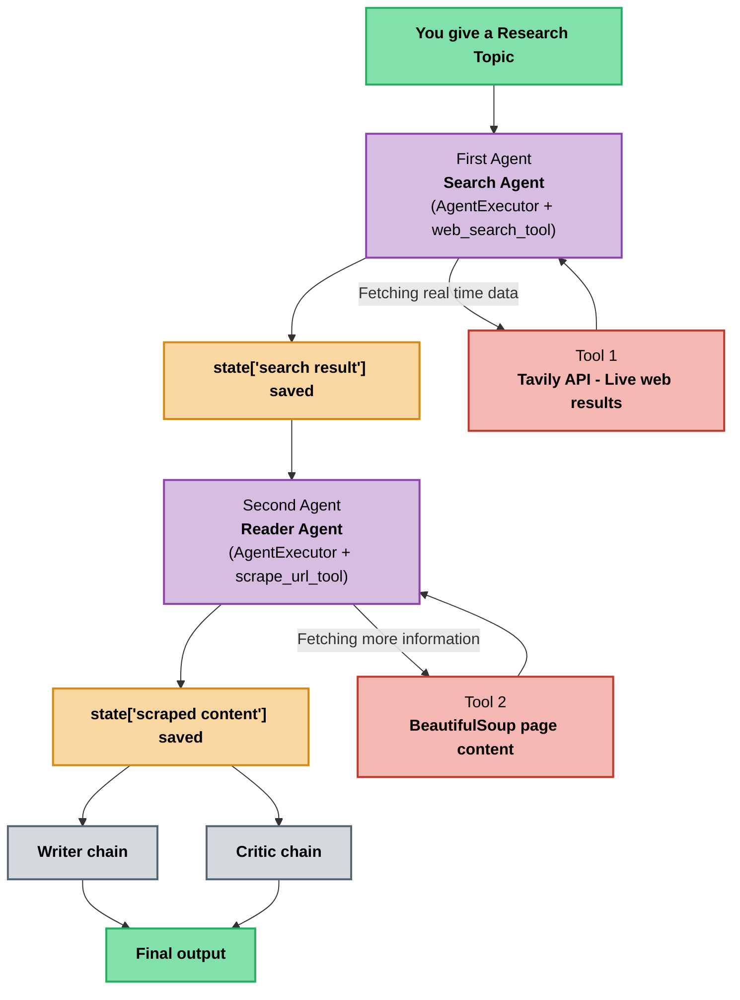

# SYNTHEA : Multi-Agent Research Assistant

## Overview

Synthea is a fully autonomous AI system designed to act as a Multi-Agent Research Assistant. Instead of relying on a single AI to answer questions from memory, Synthea deploys a team of specialized, intelligent agents that collaborate to produce professional research reports on any given topic.

The system leverages Large Language Models (LLMs) connected through LangChain's modern LCEL pipeline and is orchestrated via a shared memory system, allowing the agents to operate as one unified brain. This production-level agentic AI architecture goes beyond simple Q&A tools to autonomously think, search, read, write, and review.

## System Architecture & Workflow

Below is the visual flow of the multi-agent pipeline:

### Pipeline Breakdown

The pipeline consists of four specialized agents/chains working in a continuous state-driven workflow:

#### 1. The Input

* **User Action:** You provide a specific **Research Topic**.

#### 2. Search Agent (First Agent)

* **Role:** Goes out on the live internet to find the most relevant and recent sources.
* **Components:** `AgentExecutor` + `web_search_tool`
* **Tools Used:** **Tavily API** (Fetches real-time, live web results).
* **State Update:** The findings are saved to `state['search result']`.

#### 3. Reader Agent (Second Agent)

* **Role:** Dives deep into the sources found by the Search Agent, scraping and extracting meaningful content.
* **Components:** `AgentExecutor` + `scrape_url_tool`
* **Tools Used:** **BeautifulSoup** (Scrapes webpage content).
* **State Update:** The extracted data is saved to `state['scraped content']`.

#### 4. Writer Chain

* **Role:** Takes all the gathered intelligence from the scraped content and crafts a well-structured, detailed report.

#### 5. Critic Chain

* **Role:** Acts as a senior researcher reviewing a junior's work. It reviews the entire report, scores it, and provides feedback to refine the final output.

#### 6. The Output

* **Final Delivery:** Both the Writer Chain and Critic Chain converge to produce a polished, comprehensive **Final output**.

## Tech Stack

* **Framework:** LangChain (LCEL Pipeline)
* **Core:** Large Language Models (LLMs)
* **Search Integration:** Tavily API
* **Web Scraping:** BeautifulSoup
* **Architecture:** State-driven shared memory system
